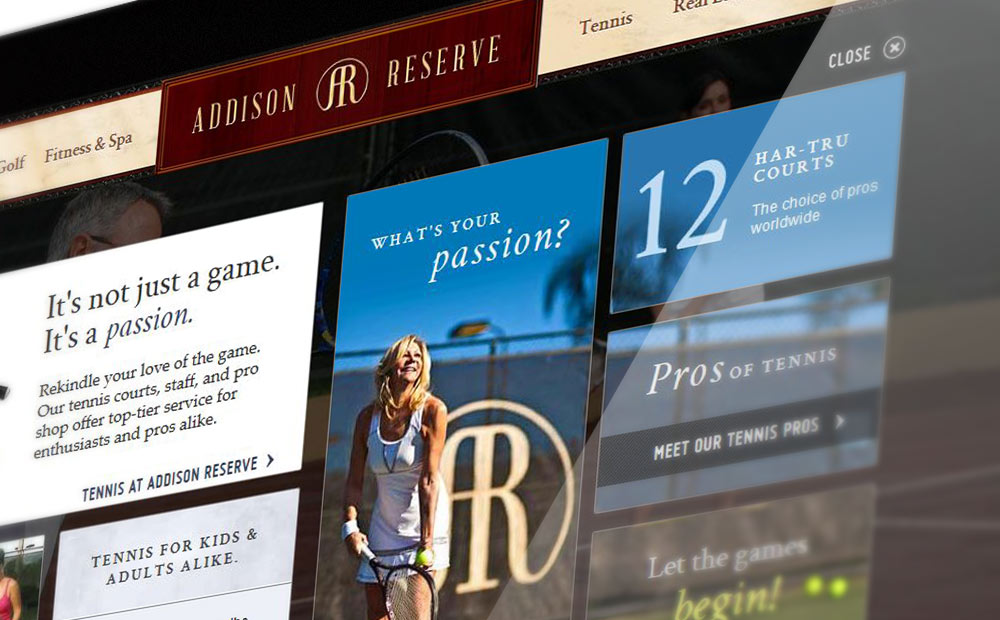
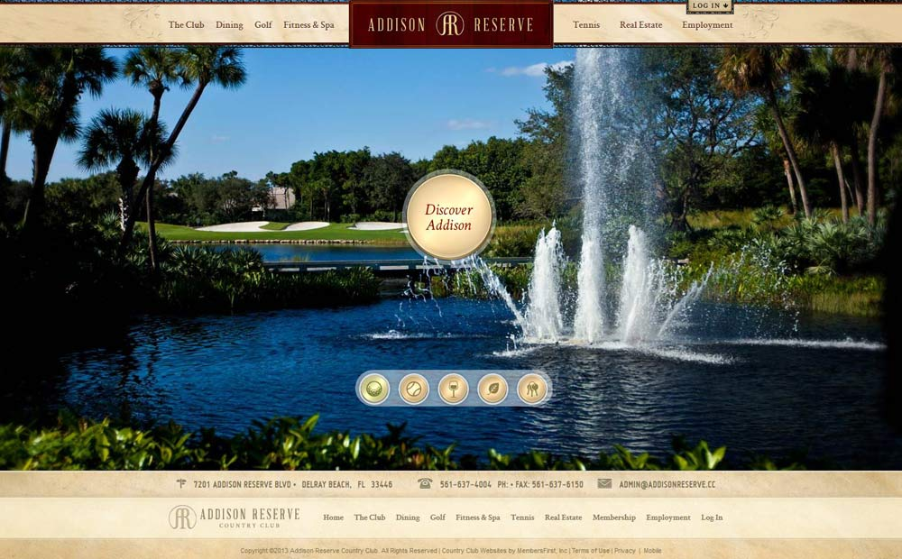
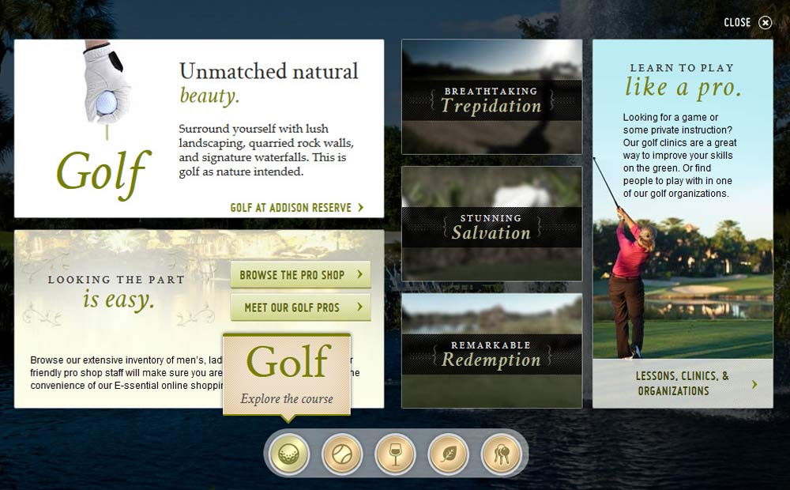
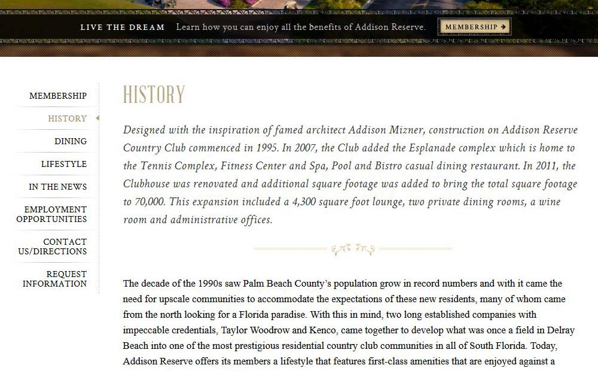
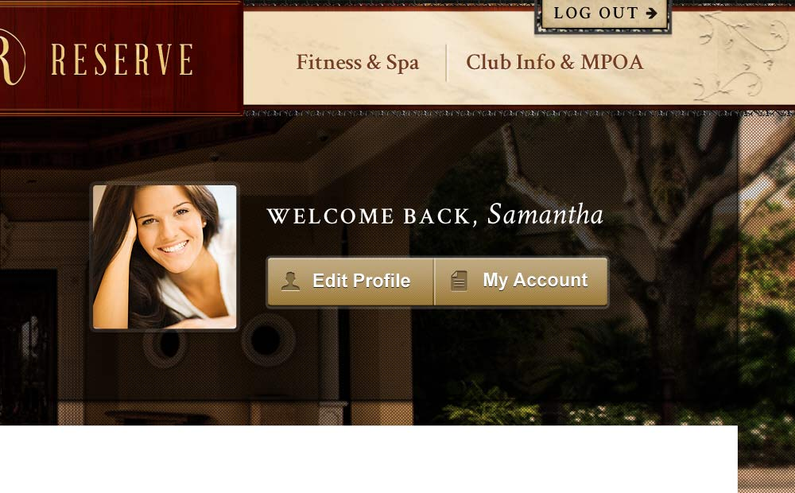
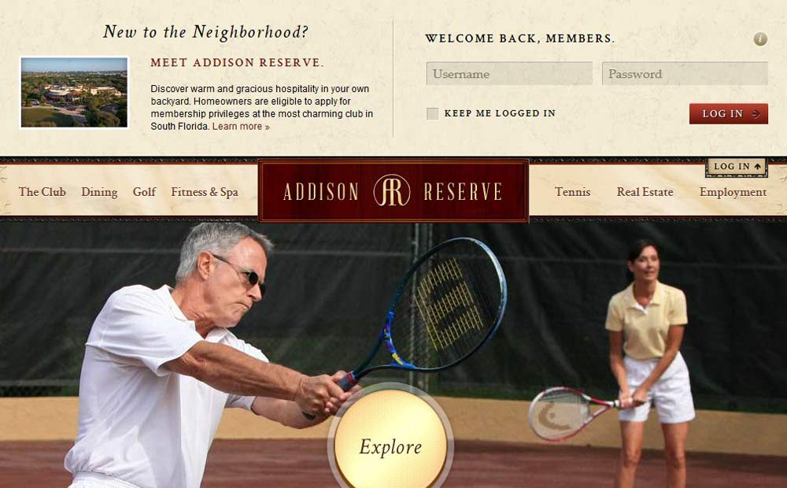

[Addison Reserve](https://web.archive.org/web/20131112131722/http://www.addisonreserve.cc/Club/Scripts/Home/home.asp) is a country club in Delray Beach, Florida, that wanted to show off major renovations and tell a new chapter in the club’s story. 





To do this, my teammates and I came up with the concept of taking visitors to the site on a club tour through the homepage. I was tasked with creating wireframes, final mockups, copywriting, and coding of the final site.





The homepage opens with a rotating slideshow, giving a quick visual overview of the club’s offerings. From here, users are invited to “Discover Addison” or use the controls near the bottom of the page to switch slides. The hover state on the large button gives a preview of that tour’s layout and encourages clicking by changing to “Explore”. Panels then open, revealing highlights, video tours, galleries, and links further into the site. 





Users choose which areas interest them, leading them to relevant sections of the site and increasing the odds of generating leads. Multiple types of content, brief copy, and dynamic layouts between each slide keep the user engaged and informed.





On long pages like the History page, the site borrows elements from print design, such as introductory paragraphs and pull quotes. This breaks up the page into manageable chunks of information while showcasing the elegant feel of the facilities. 





Textures such as the gleaming marble, embossed leaves, and cherry wood in the navigation highlight the club’s architectural details.



 

Finally, a constant opportunity to pursue membership lives in the banner image sitewide, ensuring users always have an easy avenue to the main goal of the site.

This website was recognized with a [Best in Class - Lifestyle | 2012 Interactive Media Awards](https://interactivemediaawards.com/winners/certificate.asp?param=268253&cat=1) by the Interactive Media Council.