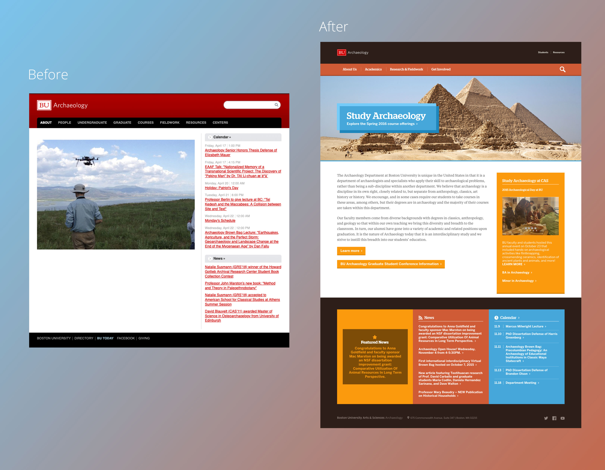
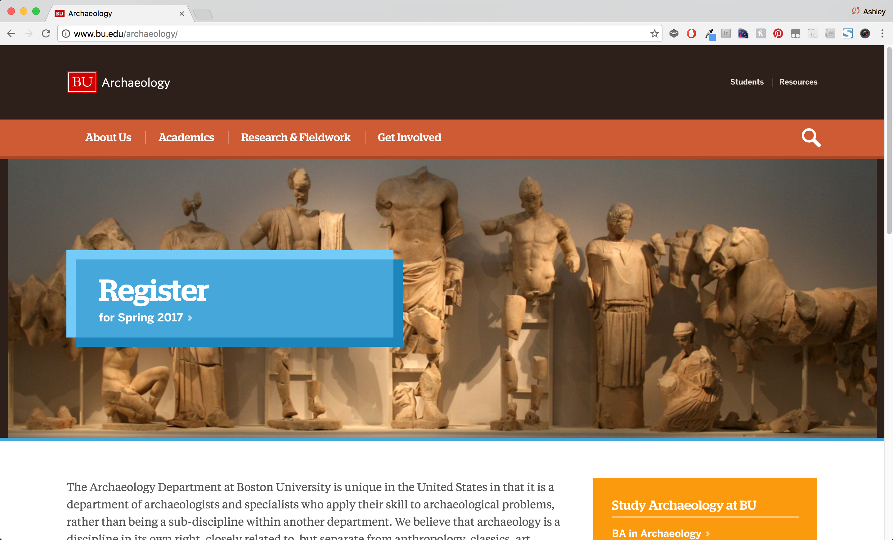
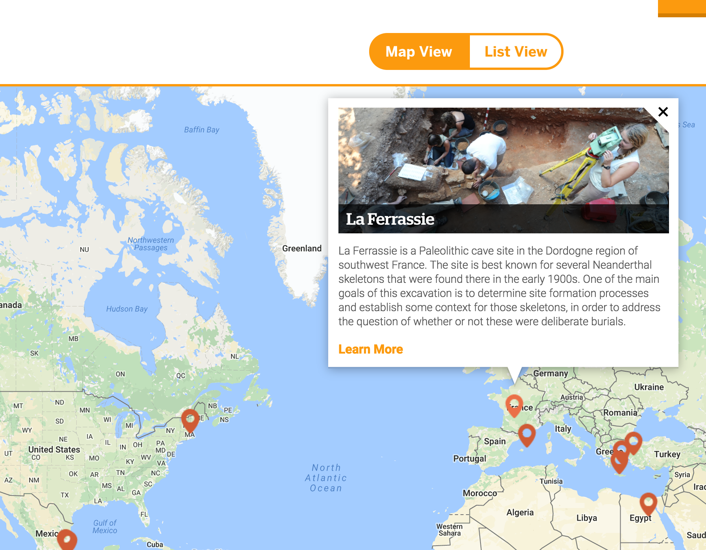

The [Boston University Archaeology Department](https://web.archive.org/web/20151113151404/http://www.bu.edu/archaeology/) is home to over 100 faculty, staff and students who specialize in and study archaeology. The primary goals of this redesign were to more clearly show their worldwide research & fieldwork, and create connections to students by more clearly showing the wide variety of news and events that were happening in the department. I began by showcasing their stunning photography, and pulling out a mixture of earthy and sky colors to match the scenes without creating an overly academic or "stuffy" feel.





I made several content recommendations to make the best use of this small project's budget, including utilizing the available space on the page to speak to the department's unique benefits and provide a clear call to action to learn how to study Archaeology at Boston University.





I also recommended several changes to simplify the sitemap and reduce the total number of choices a prospective student needs to read through in the primary navigation from 8 to 4. This helped make it easier to more clearly focus on their Research & Fieldwork page.





I then worked with [Eveleen Sung](https://www.google.com/url?sa=t&rct=j&q=&esrc=s&source=web&cd=&cad=rja&uact=8&ved=2ahUKEwjbk-bK2s74AhUWAp0JHXL4AVMQFnoECAQQAQ&url=https%3A%2F%2Fwww.linkedin.com%2Fin%2Feveleensung&usg=AOvVaw1pheqV1E7CCT9f3YJYukGR), a fantastic developer who went on to work at Microsoft, to design and develop a [custom Google Map](https://web.archive.org/web/20151113151404/http://www.bu.edu/archaeology/research-fieldwork) for the Research & Fieldwork page. The map shows where the department has completed research or fieldwork studies, along with a brief description of the project and an image, if it exists. A user looking for a specific project can also use a list view to quickly browse projects and get information on each.