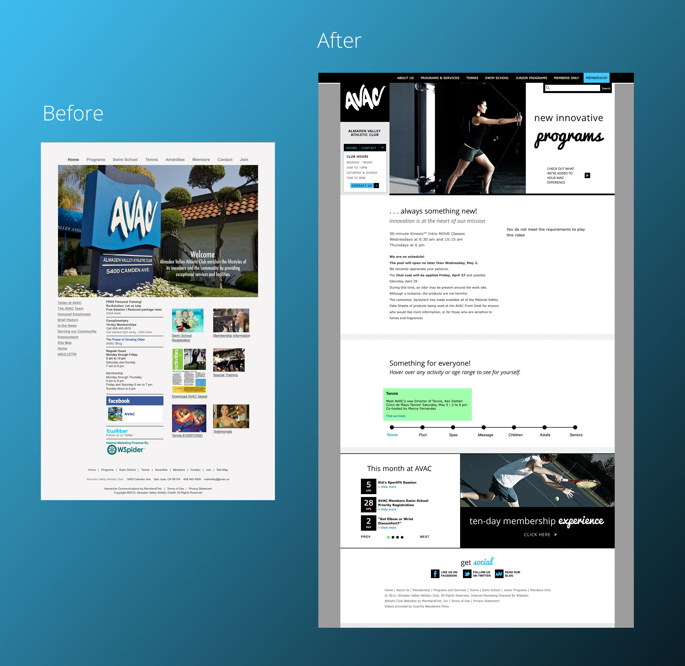
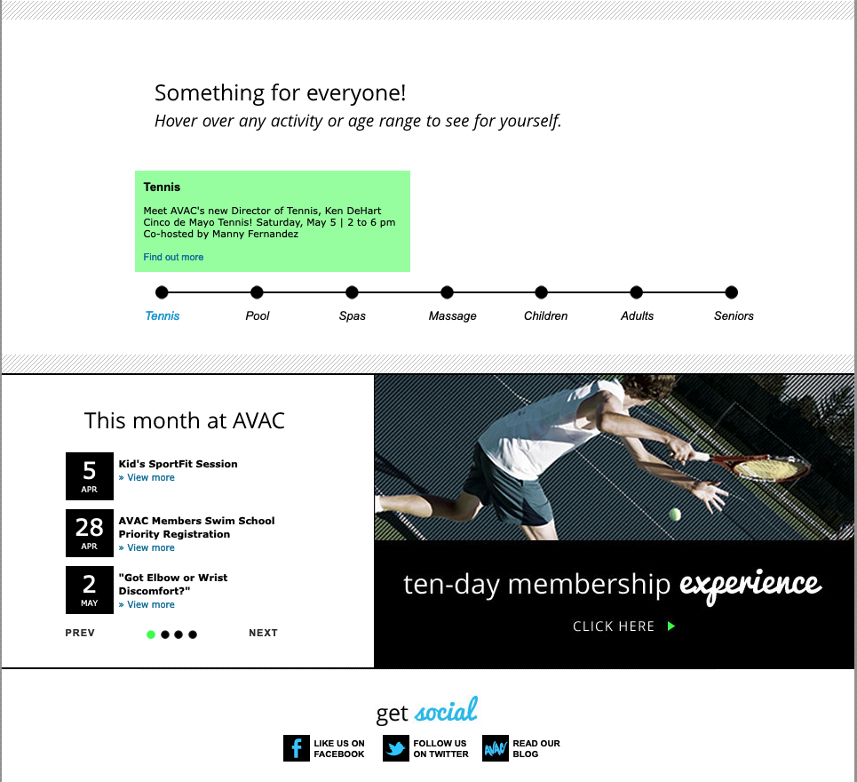
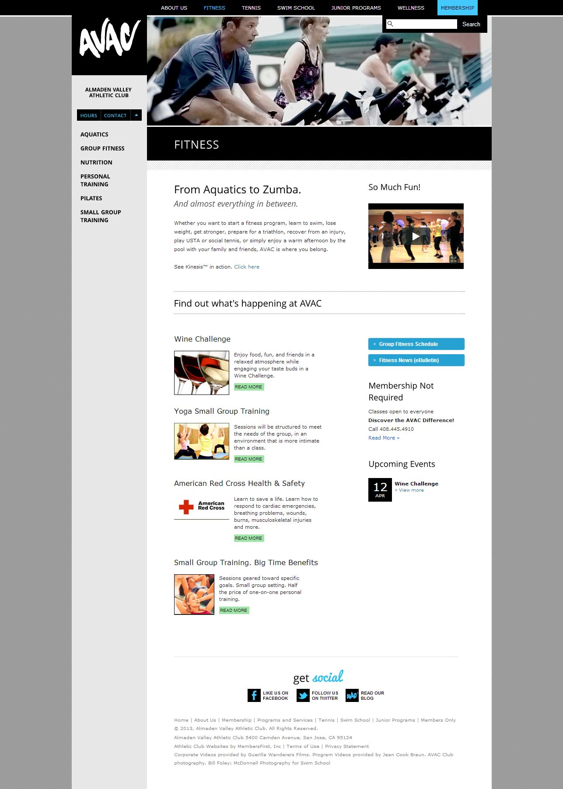
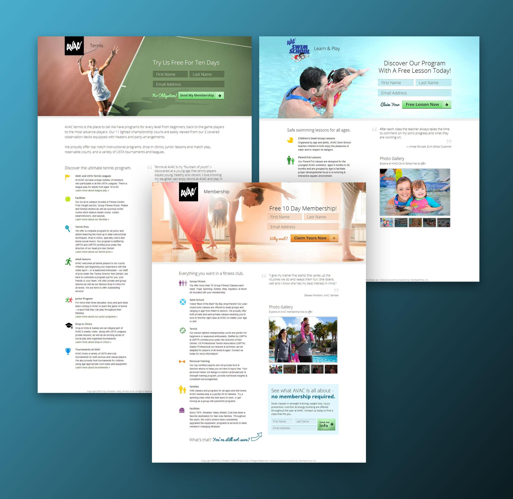

[Almaden Valley Athletic Club](https://web.archive.org/web/20120427075558/http://www.avac.us/club/scripts/section/section.asp?NS=HOMEA) is the premier running and fitness club in San Jose, California. Their goal is to provide members a comfortable, friendly environment for both cardiovascular training and socializing with a selection of fitness equipment and activities that meet everyone's needs.





When I redesigned this website in 2011, I immediately saw potential in the movement of their logo that wasn't being drawn out in their current website. Key content strategy changes included content recommendations such as increasing the prominence of hours on the homepage to make them easier for users to find, and introducing search to the website. I also focused on their brand colors, black and blue, and struck a balance between modern and playful elements with a sans-serif typeface next to a chunky script.



  

     <video autoplay loop muted>
        <source src="/img/avac-slides.mp4" type="video/mp4">
        Your browser does not support the video tag.
      </video> 
  



To capture the sense of movement that was in the logo in other places in the website, I implemented [jQuery Cycle](https://jquery.malsup.com/cycle2/) and used a combination of the curtain effect and a delay to get the one-by-one movement you see here. The recording above is from archive.org and was taken about a decade later. It's aged relatively well, though the animation timing isn't quite perfect on all slides like it was when I launched it. 





Throughout the homepage, I strove to create a sense of wonder and exploration regarding the club's offerings that would stand out amongst competitors, including a "timeline" style format for exploring different offerings by age range or activity.





This website used a custom content management system by [MembersFirst, Inc](https://www.membersfirst.com/). Layouts and content like this were fairly standard at the time, and a big step forward in engaging members in current events, as well as showcasing the wide variety of activities available to prospective members. Some of the technical challenges included slicing HTML into individual chunks which would work in the custom system's templates, and identifying repeatable components.





Later, when the club wanted to create targeted marketing for specific programs, including their tennis program, swim school, and membership, I was able to extend the new design to bright and airy landing pages which highlighted key benefits and drove increased signups using a top of the page form.