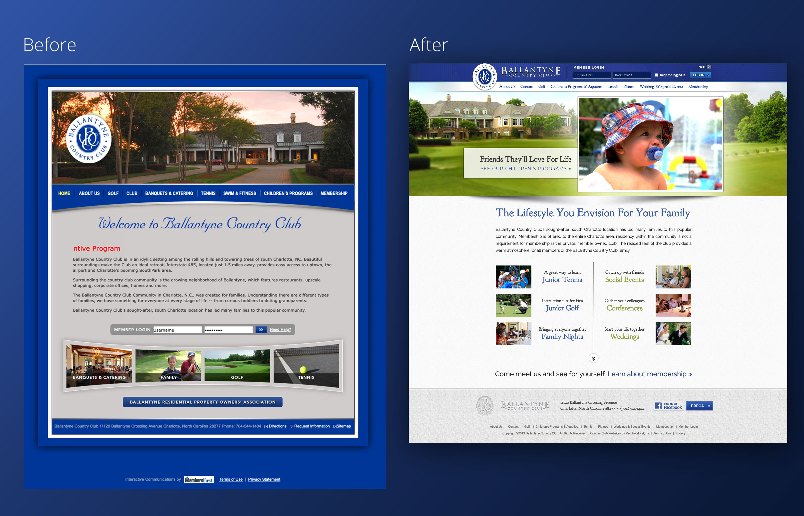
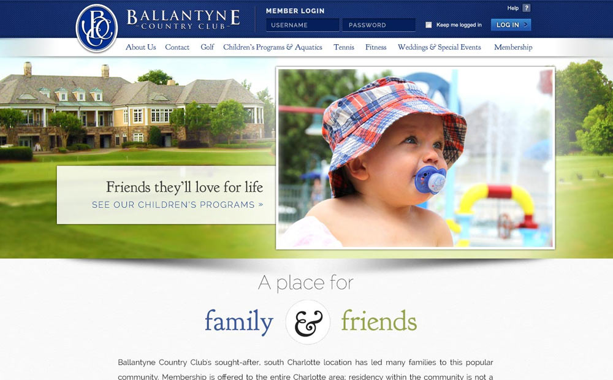
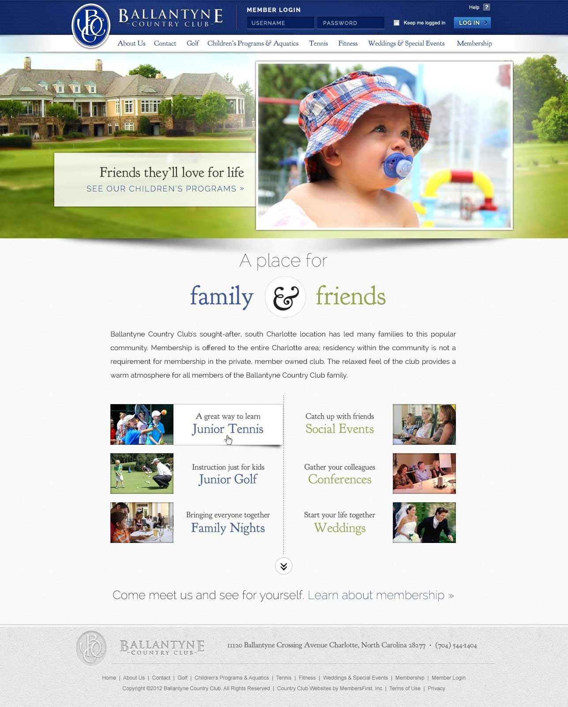
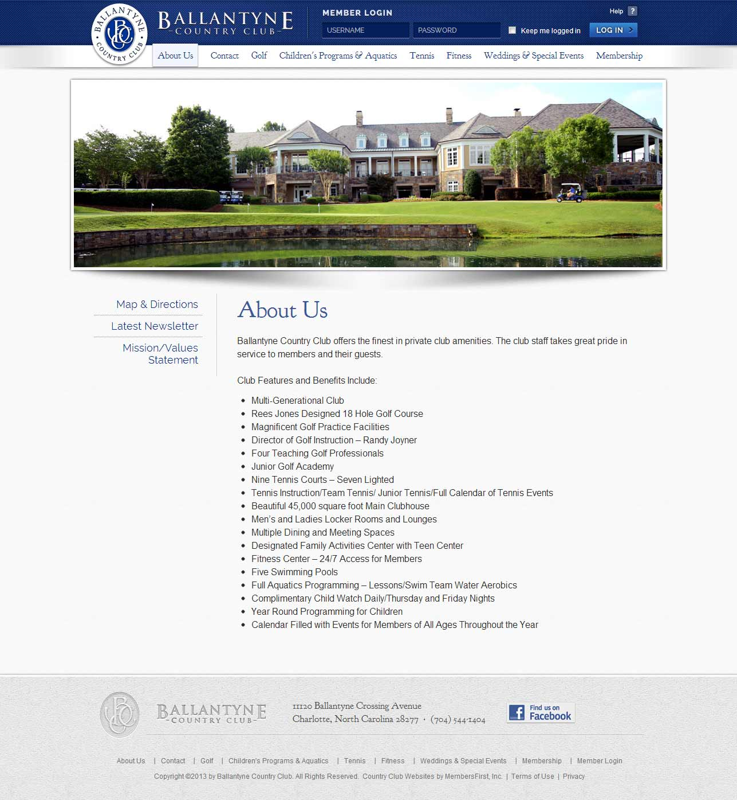

[Ballantyne Country Club](https://web.archive.org/web/20130901010055/http://www.ballantyneclub.com/Club/Scripts/Home/home.asp) is a family-friendly country club that offers a wide range of services to its members and the community. including challenging golfing and beautiful natural area access. Because it is located in one of Charlotte’s most popular neighborhoods, it's easy to access from anywhere in the city and bring the family as well.





While the original website used their brand colors, the bright blue was overwhelming when used as a background color, and the script font and silver background made the website feel a bit heavy and dated. One of the first things I knew I wanted to do was darken the blue a bit at the edges, use it as an accent color, and go to a white background to transform the site from traditional to family-friendly.





When I redesigned this website in 2013, a key goal was to help prospective members better imagine how Ballantyne could fit with and support their family's lifestyle, while better leveraging photography and space on the page. In my original design, I used a special ampersand design to carry through the elegant feel while focusing on the community and family aspects of the club. I also suggested copy for the banner area, and chose images which resonated with the intended tone and goals of the site.





I redesigned the homepage to direct the user's attention through two sets of calls to action - one focused on the amenities that would fit a family, and one set of calls to action focused on offerings that supported building lasting friendships. The final call to action leads to membership, effectively introducing new users to benefits before letting them know how to participate.





I used textures from the club's architectural materials and shadows to provide a sense of warmth and depth throughout the website, even on informational pages.