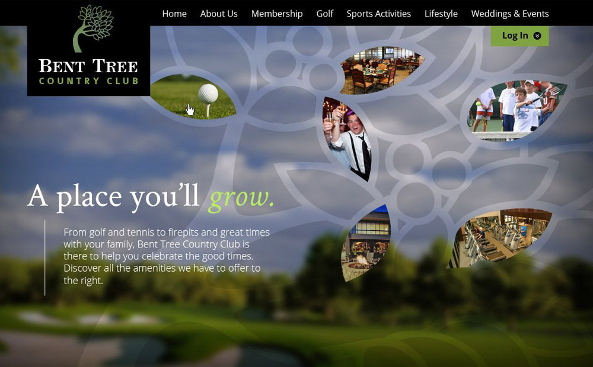
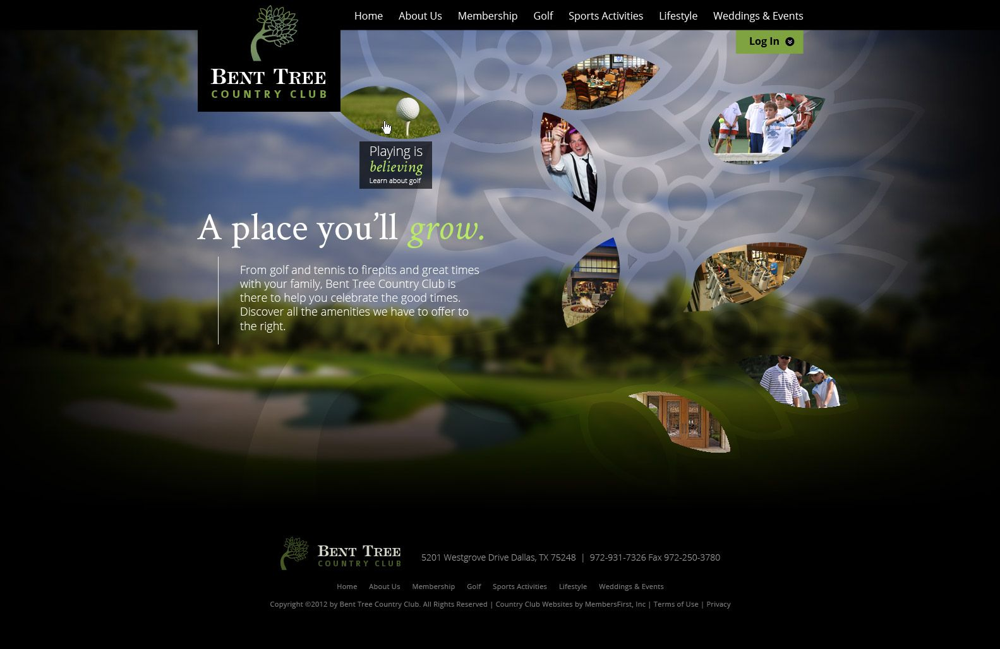
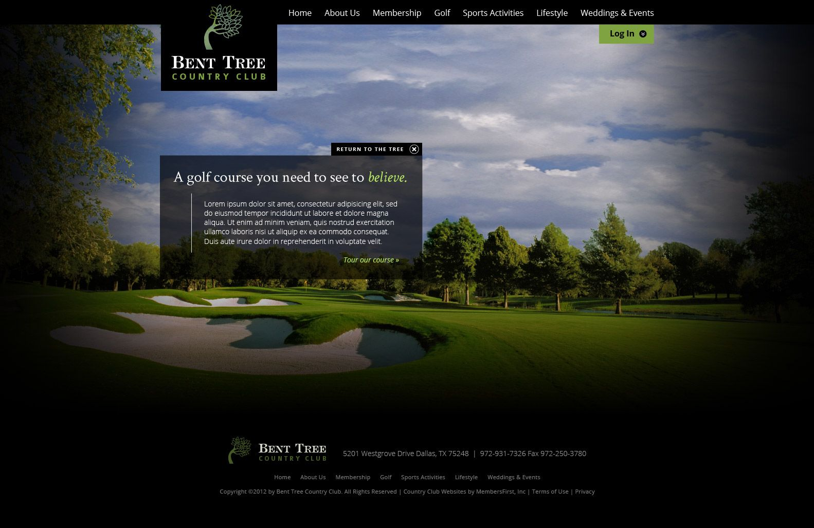
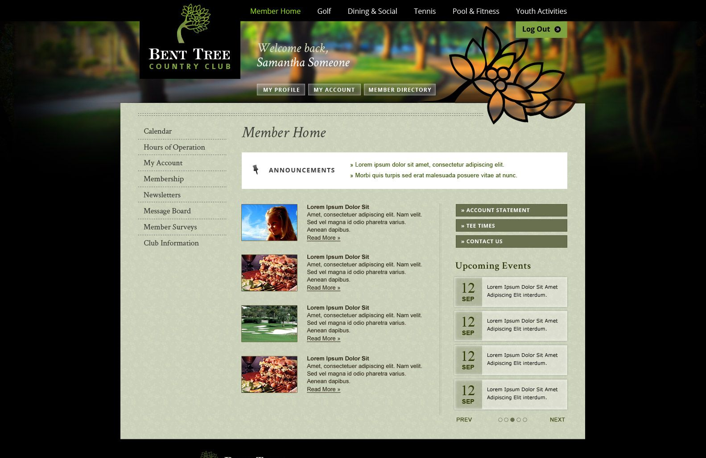
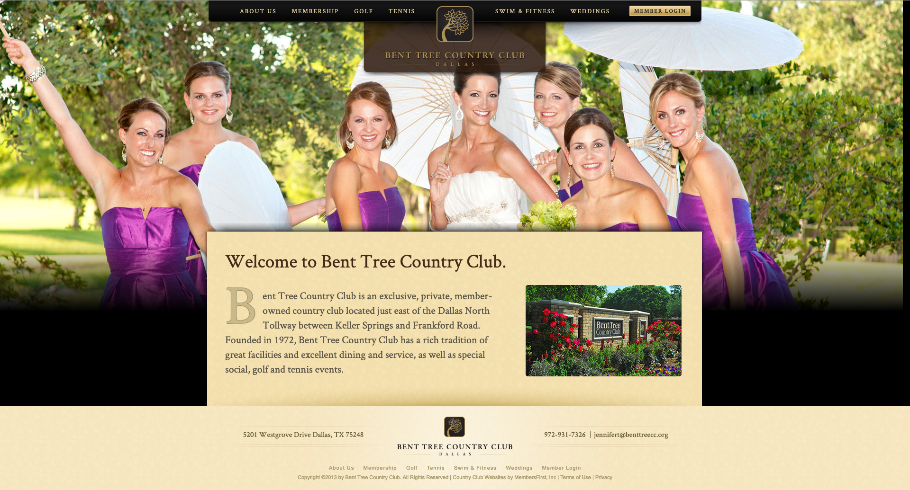

[Bent Tree Country Club](https://web.archive.org/web/20130911035604/http://www.benttreecc.org/Club/Scripts/Home/home.asp) is a private golf and country club located in the heart of the Raleigh-Durham area. The club is home to a championship golf course, tennis courts, swimming pool, fitness center, dining, and social activities. 





The goal of this redesign was to create a website that would build community and showcase the club’s amenities. Initially, the club wanted to get away from a traditional feel, and promote community above tradition. I began by creating a custom tree motif based on their logo for the website that would serve as a unifying element throughout the site, reinforce their brand identity, and set them apart from other clubs in the area. 





I used photography to showcase the club’s beautiful natural areas and architecture, and created custom callouts in the shape of leaves to highlight the club’s golf, dining, and social amenities. In the first iteration of this design, when a user would hover over a leaf, it would show a larger version of a photo in the background which helps the user imagine themselves using the amenity they are exploring. along with additional information about what Bent Tree has to offer.





I took care to integrate small details into the final design which would give a sense of depth to the design, such as the cut out leaf motif on the membership page, to give a sense of refinement while maintaining the community and brand integration. Throughout the design, I suggested microcopy for banners which aligned with the club's brand identity.





Ultimately, [the club asked that I go in a more traditional direction](https://web.archive.org/web/20130911035604/http://www.benttreecc.org/Club/Scripts/Home/home.asp), closer to their original color palette, so as not to alienate existing members, and simplify the design. I was able to accommodate this by removing the tree motif, emphasizing texture, and changing from a green-based color palette to a more traditional gold palette.





Elements in the website that tie the brand together, such as the typography, remained the same. This project is an excellent example of how I was able to pivot mid-design to accommodate a new direction, and still accomplish the project goals on time and on budget.