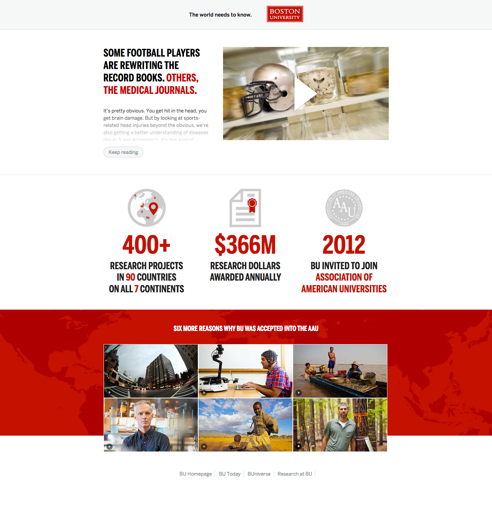

[The World Needs to Know](http://www.bu.edu/discover/) was an advertising campaign [produced in collaboration with Allen & Gerritsen](https://www.nytimes.com/2011/09/26/business/media/boston-university-advertises-on-a-needs-to-know-basis.html) to promote Boston University's world-class research and make deans, provosts, and presidents of other universities aware of Boston University's growing rankings, as well as invitation into the [Association of American Universities](https://www.aau.edu/).





My role in this project was to take the ad creative and design and develop matching landing pages for each ad to direct to. Each of the seven landing pages focuses on a core area of research, and integrates video, a summary of the research and benefits, and several facts and figures proving Boston University's growing research prominence. 

Key actions the target audience could take next included exploring more areas of research or exploring key news articles, profiles, and centers within the university related to the current page's topic. A "Keep reading" button, which truncates some of the story, kept the page minimal while providing a way to measure readers' interest through analytics, several years before it was a standard pattern in online newspapers and blogs.

The campaign gained wide recognition, including pieces in [The New York Times](https://www.nytimes.com/2011/09/26/business/media/boston-university-advertises-on-a-needs-to-know-basis.html) and [Boston Magazine](https://www.bostonmagazine.com/news/2011/09/27/boston-university-ad-campaign-attempts-influence-influencers/).