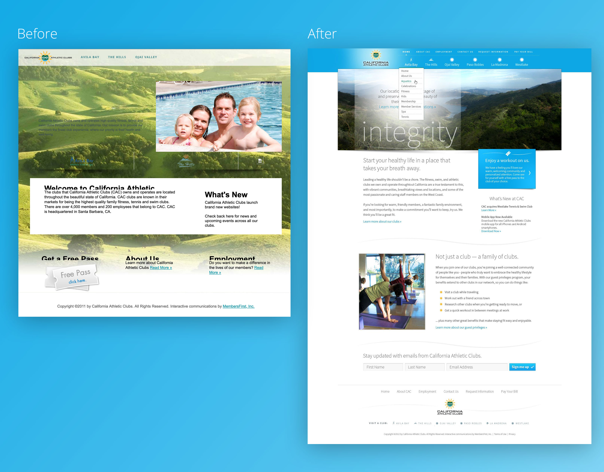
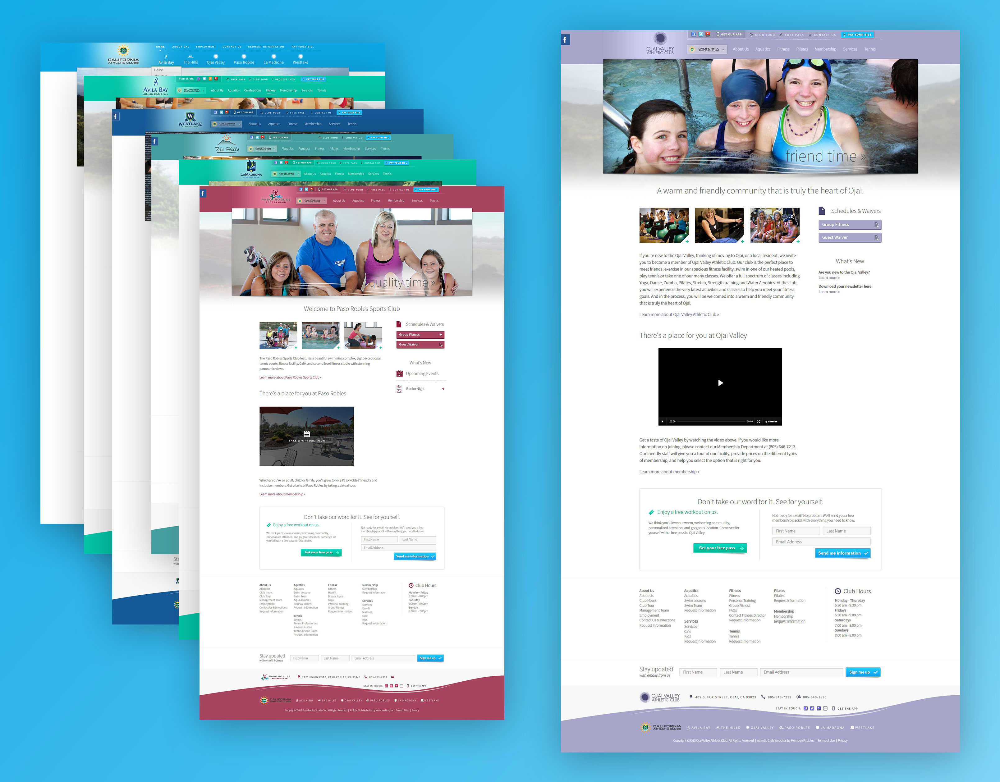
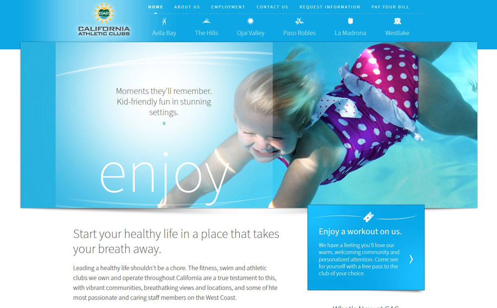
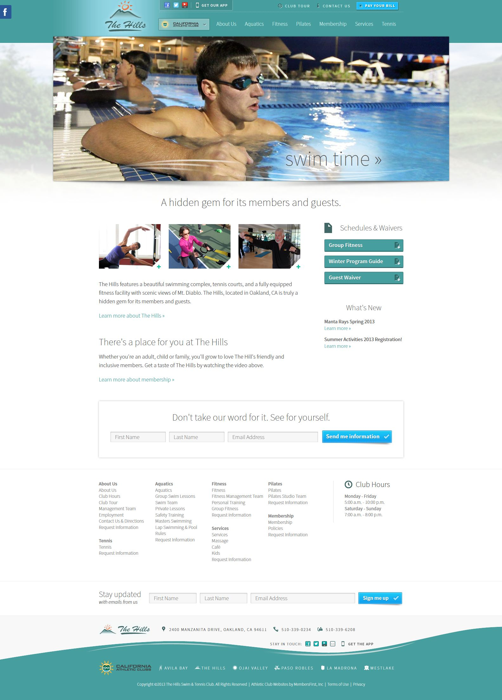

[California Athletic Clubs](https://web.archive.org/web/20130524174546/http://www.caclubs.com:80/Club/Scripts/Home/home.asp) is a collection of six private athletic clubs along coastal California, including [Avila Bay Athletic Club](https://web.archive.org/web/20130426083747/http://abac.caclubs.com/club/scripts/section/section.asp?NS=HP), [The Hills Swim & Tennis Club](https://web.archive.org/web/20130619030757/http://hills.caclubs.com/club/scripts/section/section.asp?NS=HP), [Ojai Valley Athletic Club](https://web.archive.org/web/20130619030736/http://ovac.caclubs.com/club/scripts/section/section.asp?NS=HP), [Paso Robles Sports Club](https://web.archive.org/web/20130729190118/http://prsc.caclubs.com/club/scripts/section/section.asp?NS=HP), [La Madrona Athletic Club](https://web.archive.org/web/20130531045301/http://lmac.caclubs.com/club/scripts/section/section.asp?NS=HP), and [Westlake Athletic Club](https://web.archive.org/web/20130626222426/http://wac.caclubs.com:80/club/scripts/section/section.asp?NS=HP). The brand unifies these unique clubs and sets them apart by cultivating a friendly and supportive attitude towards health and fitness.





I worked to solve two key challenges with this major redesign project: maintaining that identity across seven different websites while retaining each club's unique brand identity, and launching seven websites concurrently to ensure a consistent experience for website users. 





I started by creating a consistent design system which would work both for the California Athletic Clubs website and the individual club sites. This included creating a color palette from each club's individual brand, and adjusting saturation and lightness for each core website color so the brands maintained a cohesive look and feel across each site.







To meet the technical and timing challenge of launching seven websites in tandem, I chose to apply this design system, content strategy, and information architecture to a consistent template which all clubs used as a starting point. I chose a simple, friendly sans-serif for the body copy and headlines, which both reinforced the parent brand's goals and was unobtrusive enough to work cohesively with the varied sub-brands. 



Creating this system allowed me to save time in developing CSS for each individual club. I was able to leverage the same base CSS across clubs, while making small tweaks to color on each component to maintain individual club identity. The end result was a unified, clean experience for users which helped elevate the brand presence of all clubs as a whole.