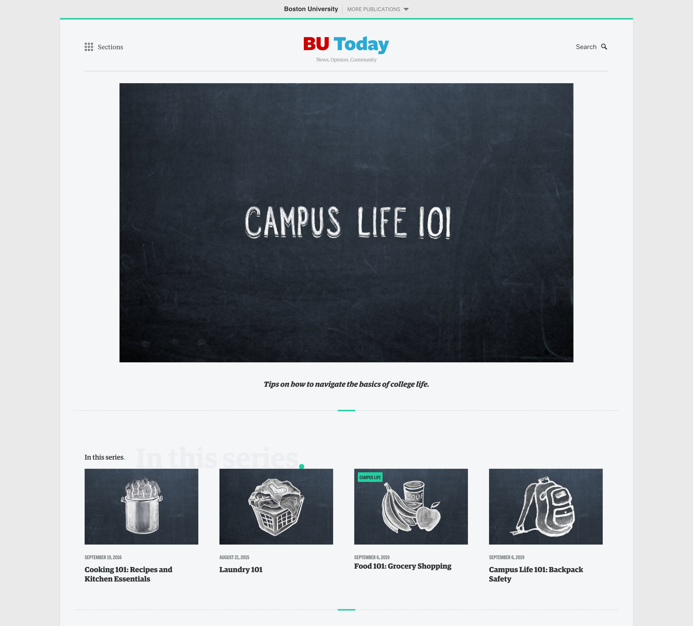

One of my best friends from this job would later comment that he wondered, "Who on earth is this weird girl doing chalkboard stuff in the corner of a web design shop?" This small chalkboard illustration project was one of my first tasks at Boston University as a lead designer. I drew several chalkboard images, which were then professionally photographed, for a Campus Life 101 series on BU Today. [See the series page here](https://www.bu.edu/today/series/campus-life-101/).

