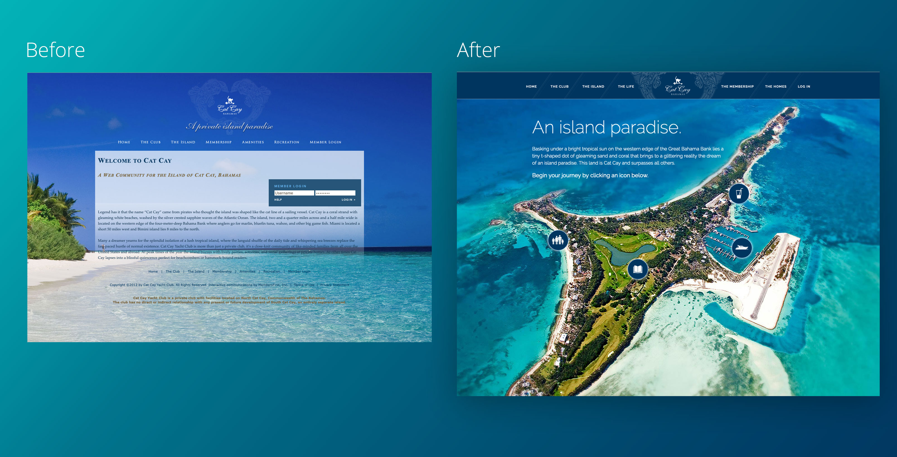
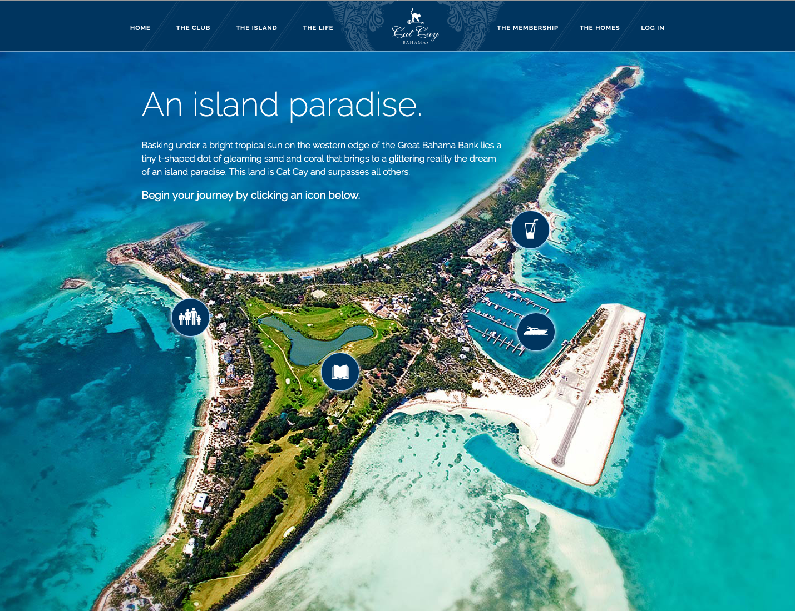
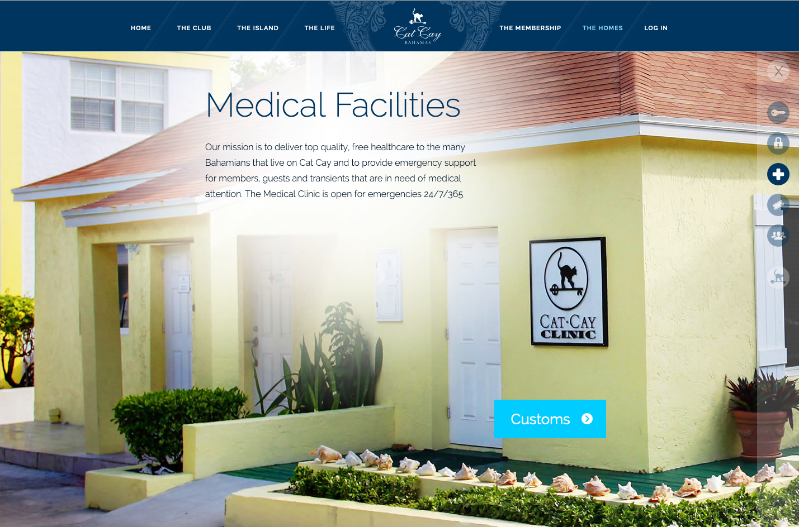
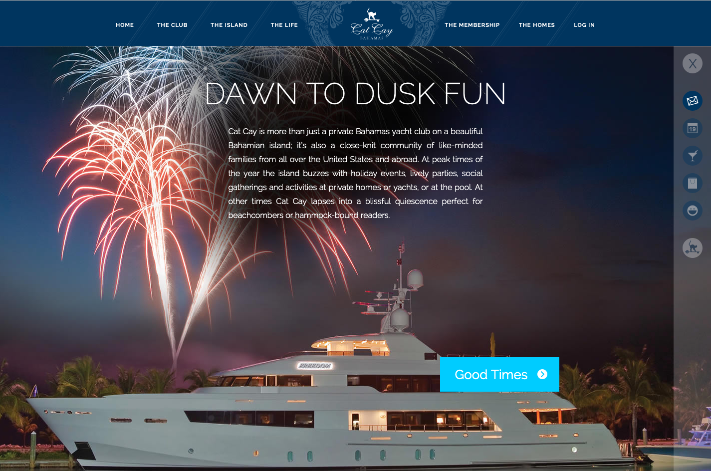
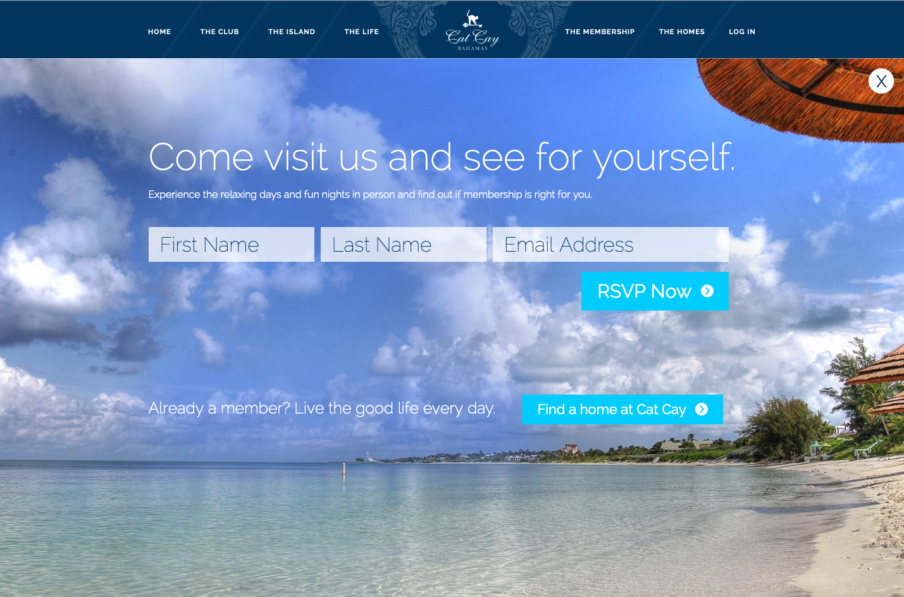
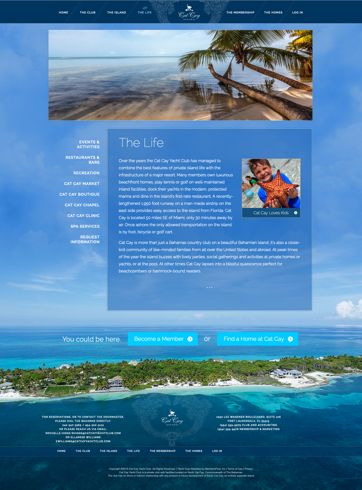
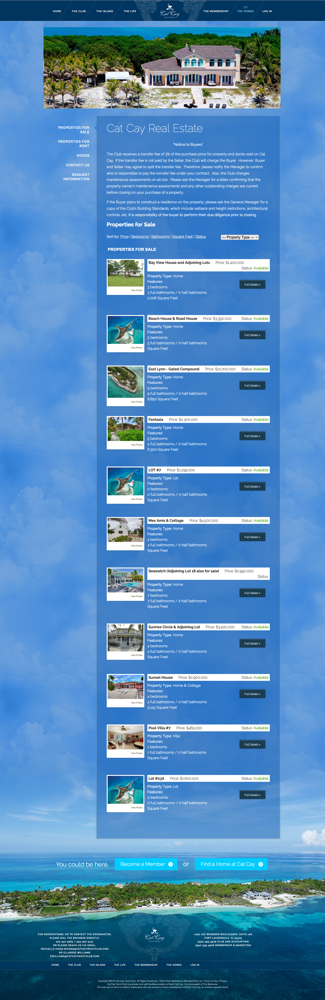

[Cat Cay Yacht Club](https://web.archive.org/web/20141216224403/http://www.catcayyachtclub.com/Club/Scripts/Home/home.asp) is a private yacht club located on the island of Cat Cay in the Bahamas which strives to provide members with an unparalleled safe and private island experience. The goals of this redesign were to showcase the island’s beauty and the club’s amenities to prospective members, modernize the look and feel to attract a younger demographic, and help prospective members better envision island life.





The original website had a lot of dense text on the page, and although it showcased an island, the photography didn't feel specific to Cat Cay itself. To bolster the brand and acheive the goal of helping prospective members envision island life at Cat Cay, I suggested using their stunning aerial photography as the basis of a map for several interactive tours.





Each icon represents a different set of unique and comprehensive benefits Cat Cay Yacht Club offers to its members. For example, the tour with a small family icon focuses on not just typical family friendly activities, but safety, security, and even an on-premesis medical facility.





Clicking on the drink icon shows a tour focused on nightlife and socialization. Each step of the tour changes the photography in the background, helping visitors picture the island in a variety of situations and times of day.





At each step, the visitor can choose to either navigate to the next step of the tour using the large call to action at the bottom of the tour page, or independently navigate to a specific area of interest based on icons in the right hand corner. 

Every tour ends with an embedded form and call to action to take a tour, creating a new opportunity to get in touch at the right time.





A part of what makes Cat Cay Yacht Club so special is that to access it, you fly in on a small plane. Instead of having a plain background, I took the opportunity to integrate this sense of aerial wonder into every page, including content-focused pages. The sky is unobtrusive, but provides texture and a delightful surprise when the user scrolls down to reveal the island's beauty sitewide. An additional call to action to join is placed right near the island, reminding visitors that wherever they are, they could be here.





Finally, for those looking for a more permanent move to the island, there are also homes available for sale. To accommodate this, I worked with a developer to integrate and style a sortable and filterable real estate listing which showcases each available home while clearly listing critical details to homebuyers, such as square footage and number of bedrooms and bathrooms.





This website was recognized with a Outstanding Achievement - Lifestyle | 2013 Interactive Media Awards by the Interactive Media Council.