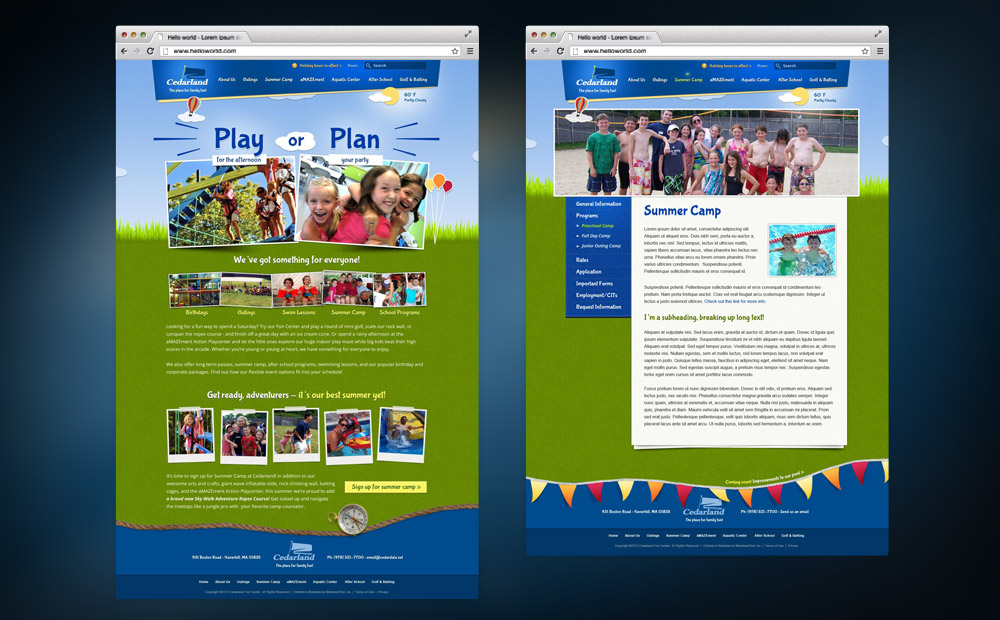
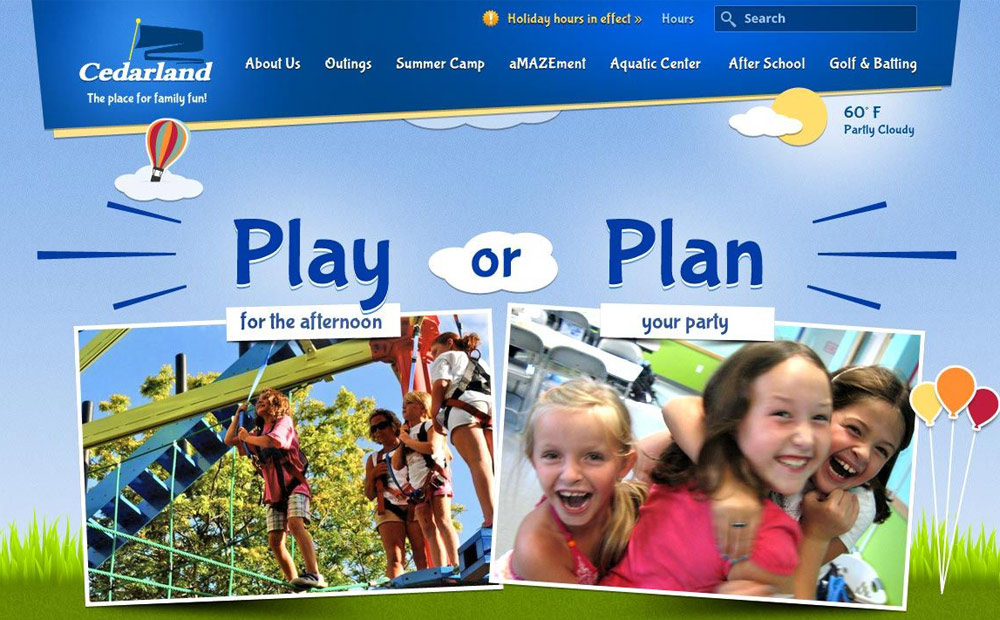
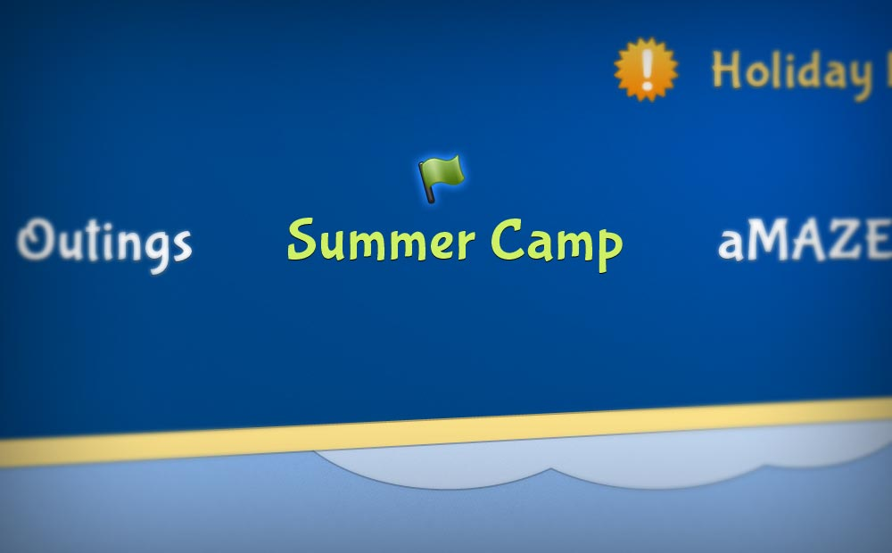
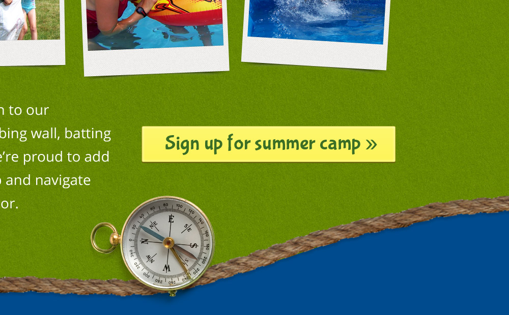

[Cedarland Family Fun Center](https://web.archive.org/web/20130411044720/http://www.cedarland.net/Club/Scripts/Home/home.asp) is a family-friendly entertainment center in Haverhill, Massachusetts. They offer a wide variety of activities including mini golf, go-karts, bumper boats, batting cages, and more. 





[The original website](https://web.archive.org/web/20130126193615/https://www.cedarland.net/) was limited in design and content, difficult to navigate, and lacked a sense of fun and community. To address this, I selected a bright and playful color palette to help the website stand out from competitors. 

I also custom animated and illustrated balloons and clouds to represent the fun and excitement of the facility, and give a sense of movement. The animation is subtle enough that it doesn’t distract from the content, but it adds a playful touch that helps users feel like they’re in a fun environment.





I refocused the homepage to call out directly to the two main tasks a user might want to accomplish on the site: learn what facilities are available on a day to day basis, or plan a party or event for the family, and suggested microcopy that was catchy and memorable to help associate the tasks with Cedarland.





I used small illustrations, including flag and compass motifs, to integrate the fun outdoor theme throughout the website on the homepage, navigation, and in the footer.





The subtle design details throughout the site elevated and evolved their brand identity, cementing Cedarland as a fun place to bring kids and plan parties for families.