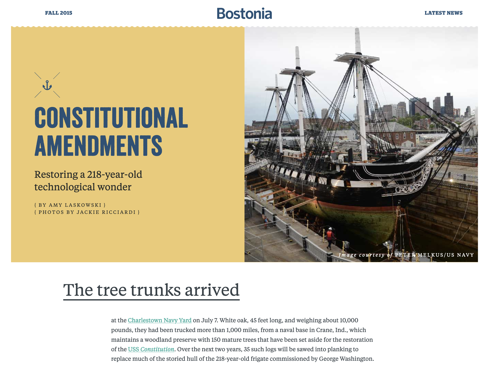
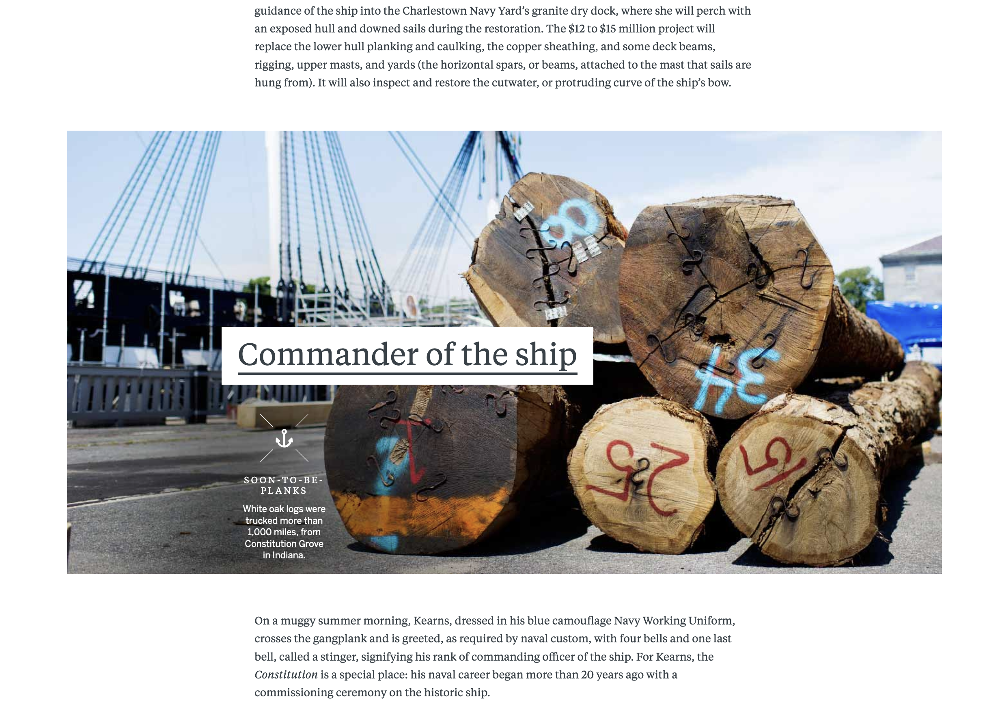
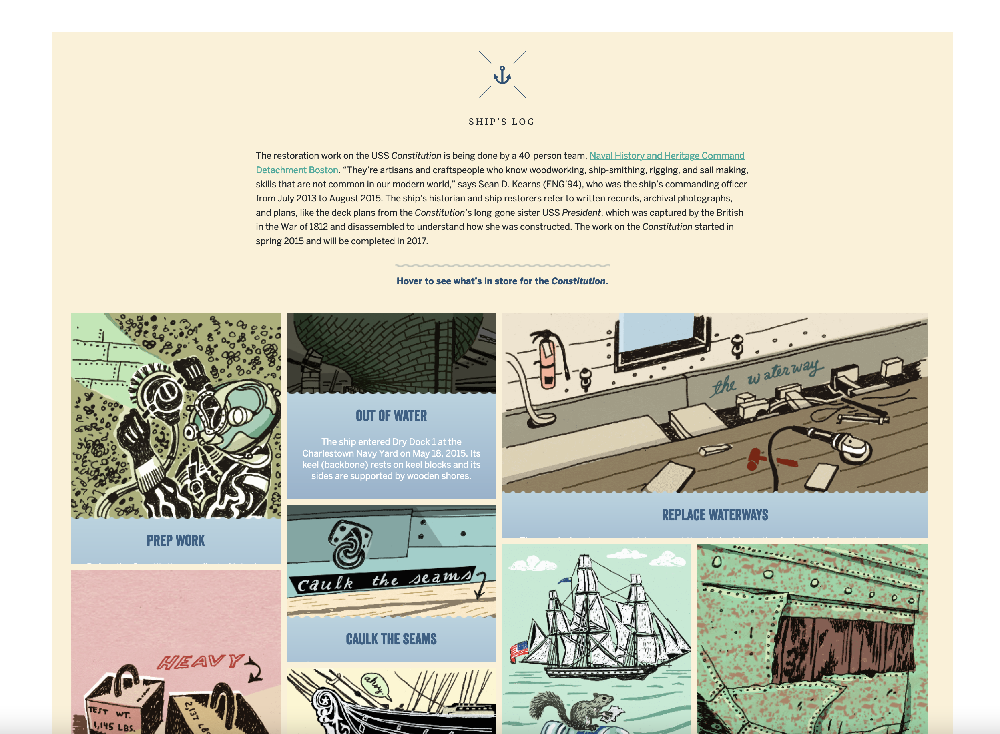

*[Constitutional Amendments](http://www.bu.edu/bostonia/fall15/constitutional-amendments/)* is an article about the restoration of the U.S.S. Constitution. I used nautical elements and gentle motion to bring a refined feel to the restoration process. I was also lucky to be able to work with a talented illustrator for a portion of the article.

**Typography details**

**Integration of custom illustrations**

[See the full article here](http://www.bu.edu/bostonia/fall15/constitutional-amendments/).