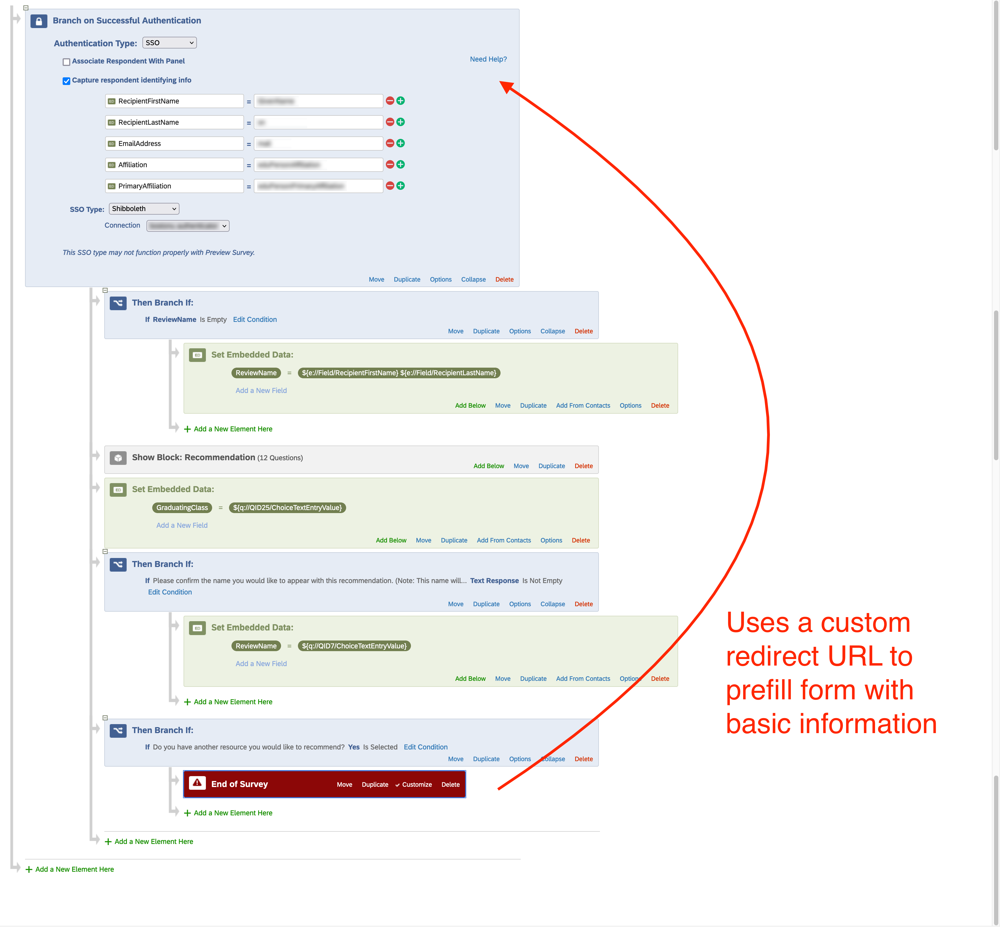

For this project, I build a custom form with an SSO connection and repeating logic in Qualtrics. The goal was to allow users who received this form to suggest multiple cultural institutions in Boston at once for the [Boston University Diversity & Inclusion Cultural Guide](https://www.bu.edu/diversity/living-in-boston/cultural-guide/) in as simple a manner as possible for the user. To do this, I used an SSO connection to prefill user data seamlessly, embedded data variables, display logic, survey flow logic, and a custom URL redirect at the end of the survey to restart the form without asking introductory questions again. This creates a loop where the user can enter as many resources as they want quickly and easily.

