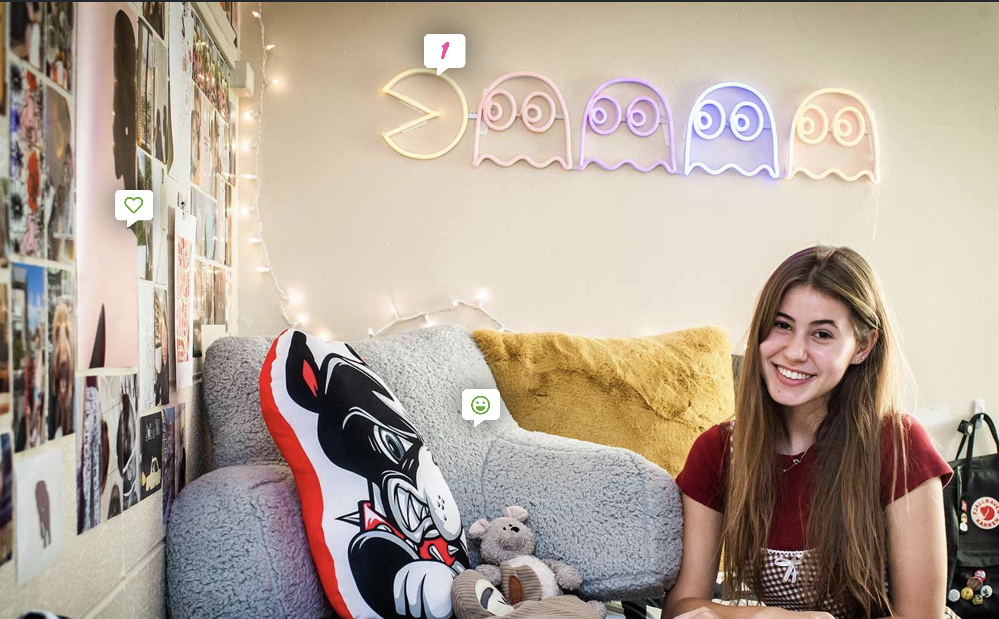
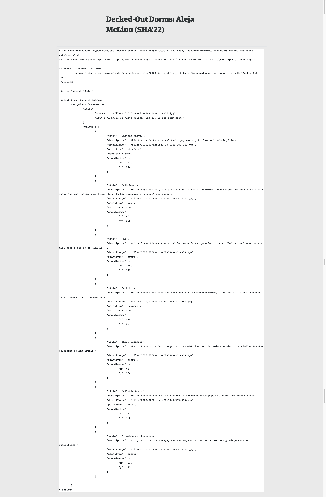

**Live links**

[Decked-Out Dorms Series page link](https://www.bu.edu/today/series/decked-out-dorms/)

[Decked-Out Dorms Story with hotspot interactivity](https://www.bu.edu/articles/2021/decked-out-dorms-lea-namouni/)

[Office Artifacts Series page link](https://www.bu.edu/today/series/office-artifacts/)

[Office Artifacts Story with hotspot interactivity](https://www.bu.edu/articles/2022/office-artifacts-andrea-merrill/)

**Visual Goals**

The BU Today team requested a new look and feel for their Decked-Out Dorms and Office Artifacts series, as well as an updated method of adding hotspots to images that took less manual work than before. Part of what struck me about this series was how creative students got with decorating within university constraints - very punk in my mind. I chose a chunky typeface, angled alignment, and SVG animation to breathe life into the dorm tours.

**Design portability**

I purposefully designed this to have a consistent look and feel across the Office Artifacts series as well, which showcases faculty and staff offices. Both use similar SVG treatments and the same codebase.

**Editing experience**

Because of budget constraints, I was unable to build a custom Gutenberg block for this series. However, I did want to make sure that the interface was still somewhat easy to edit for the staff at BU Today, who have some comfort with coding. To do this, I created a JSON object to hold structured information on each hotspot. When the page loads, I used JavaScript to pull in this information and generate the hotspot and lightbox for each hotspot when the user clicks. Some technical challenges here included adding event listeners to dynamically generated content, animating the SVG banner image, and creating an easily editable interface for highly variable content on a minimal budget.

