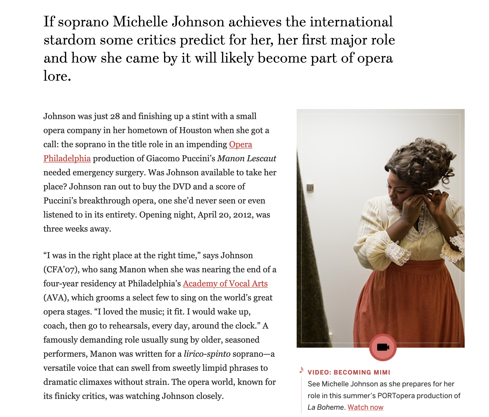
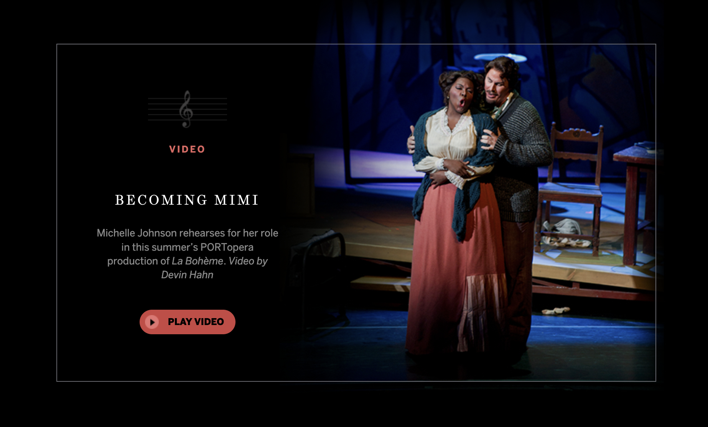
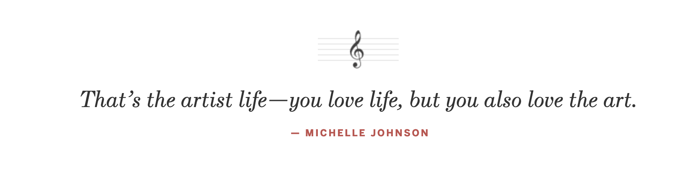

*[High Notes](http://www.bu.edu/bostonia/fall13/high-notes/)* is a behind-the-scenes article about opera singer Michelle Johnson's performance at the Met. I used bold, bright colors from her costumes against dark backgrounds and serifs to create an elegant, yet dramatic visual piece.

**Selected design moments**

[View the live article here.](http://www.bu.edu/bostonia/fall13/high-notes/)