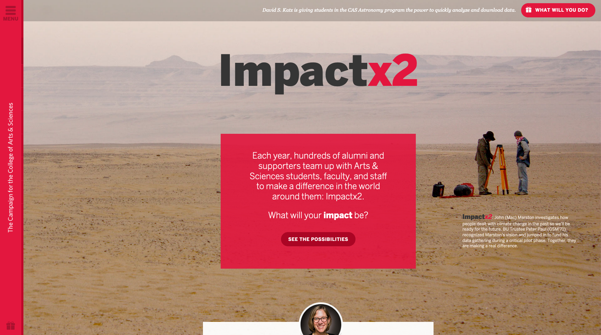
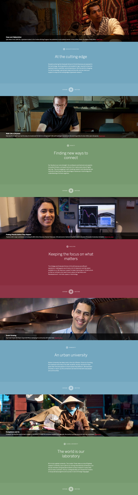
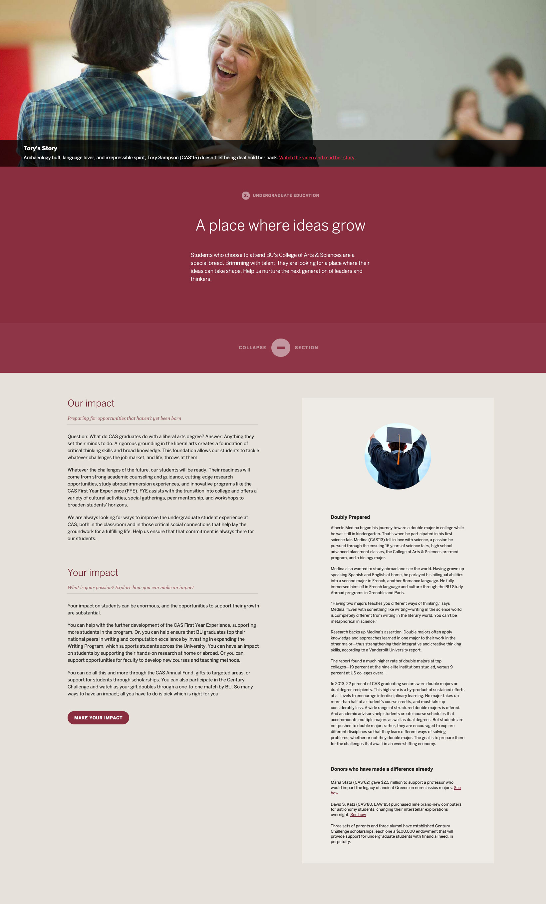
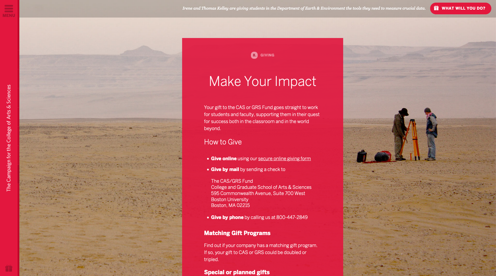

[Impactx2](http://www.bu.edu/cas/impactx2/) was a campaign for Boston University's College of Arts & Sciences which strove to inform donors on the differences that the school makes worldwide, and support the larger [Campaign for the College of Arts & Sciences](https://www.bu.edu/cas/alumni/giving/). Among the sites provided for inspiration for this project were [The World Needs to Know](/boston-university-discover-campaign-landing-pages/) and the 2013 Dining Sustainability Report.





One of the key goals of the project was to use storytelling and quality content to drive key impact points home to donors. To support this, I began by matching photography which showed human emotion and told unique stories with each impact point's content. Each point has a separate color to help make it clear to the viewer that they've changed sections.





As each section changes, content is animated in dynamically for a smooth, single-page experience. The browser history updates seamlessly, and each section can be individually linked to. If JavaScript is not enabled, the website functions normally, with all sections expanded and a persistent navigation which links to each section as a page.

These sections expand to reveal content which supports the Impactx2 concept—Our Impact, and Your Impact. From there, a potential donor has a clear call to action to donate, and can see a story about how Boston University had a personal impact on a student, faculty member, or staff member.





All of this leads to the final call to action to site visitors to match the impact that the students, faculty, and staff of the College of Arts and Sciences have already had by giving back to support future impacts—Impactx2.





The [Impactx2 website](http://www.bu.edu/cas/impactx2/) was recognized with a Gold, Websites: Fundraising (Annual, Special Campaign) | 2015 CASE District I Communication Awards by the Council for Advancement and Support of Education.