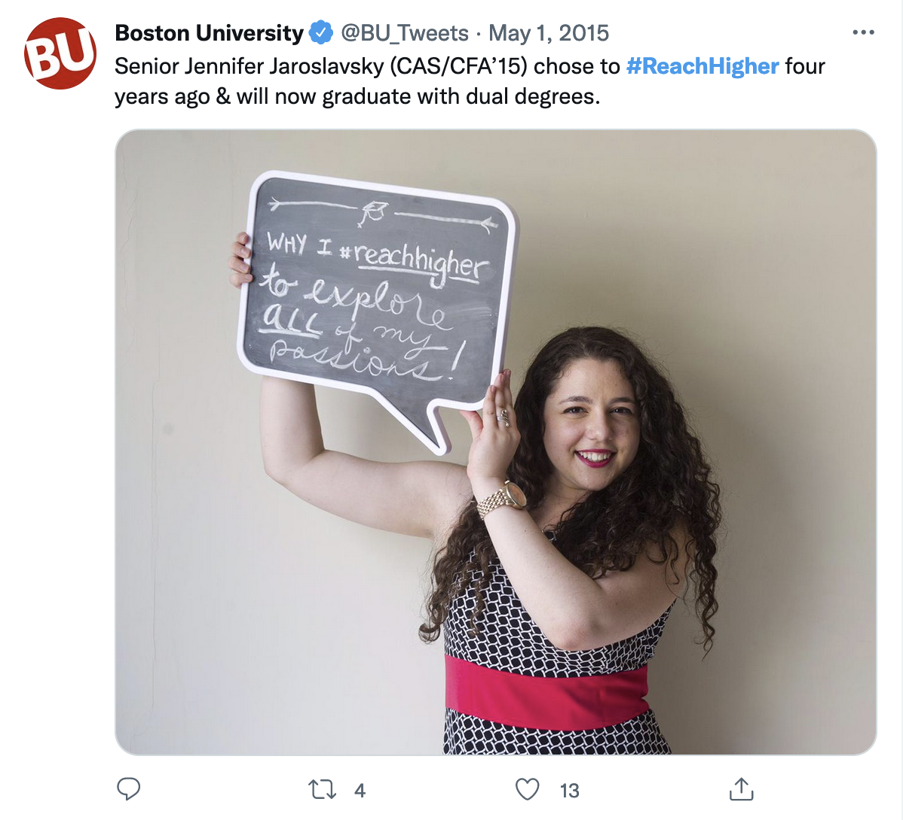
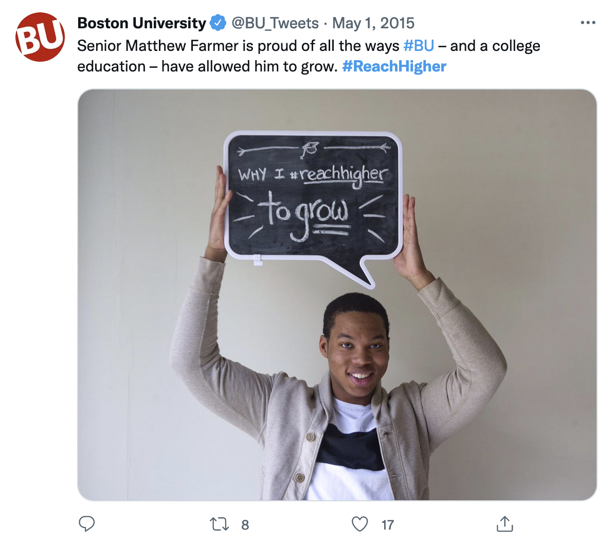

As part of a social media campaign for the White House, Boston University Public Relations created content to post to Twitter and Instagram [using the hashtag #ReachHigher](https://twitter.com/search?q=%23reachhigher%20from%3ABU_Tweets&src=typed_query). Their in-house photography team reached out to me to create custom chalkboard lettering for several students on set based on each student's personal reasons for going to college.

