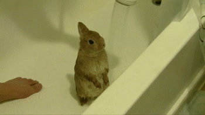

Inspired by this [\#DevDiscuss](https://twitter.com/hashtag/DevDiscuss?src=hashtag_click) on Twitter:



This is the advice I gave folks in my department when starting our code review process up, and three years later, it's still going strong.

Bunny gifs are critical to the messages that follow and are included here for improved understanding of the rules.

- - -

## Keep your review requests small and focused.

This helps your reviewer get feedback to you in a timely manner.

- - -

## Try to get to a review the same day it is requested.

Most folks depend on code for upcoming meetings, releases, and to keep moving on our ideas. Don’t let review requests sit.

- - -

## Approve or request changes, but never comment only.

Comments don’t give the author clear direction on whether or not they can move forward. They’re great for discussion, but it’s important to be clear about next steps too.

- - -

## Be clear about what needs addressing.

If you request changes, be clear about what types of changes are required for approval, and what aren’t, in the overall description for your review.

- - -

## Review with teaching in mind.

Code review is about helping each other and sharing our knowledge. Phrase your feedback and ideas in a way that helps others around you to learn more about your area of expertise! Don’t make assumptions or get frustrated. Help your coworkers improve instead.

- - -

## Review with empathy.

Deadlines are hard. Being new is hard. Learning is hard. We are all working to be the best people we can be, so take extra care to call out the cool ideas you see and be positive with your feedback. Use fun and appropriate emoji liberally! 🐰 Be aware of your voice and tone - humor is easily misinterpreted in text.

- - -

## Review with common sense.

If you get a review the same morning as a meeting or the week of launch, approve it, but leave your feedback anyway for when the designer or developer won’t be scrambling to improve things. Be deliberate about what’s okay to leave for later.

- - -

## Be aware that changes introduce bugs.

Each change that has to be made can impact the stability of the code. Keep this in mind as you review around tight deadlines.

- - -

## Don’t require perfection.

Your job as a reviewer is to act in the best interest of the code and the people you’re working with. Early on, asking someone to refactor repetitive or overly complex CSS or JS is a good call. During QA, it is not.

- - -

This list was taken from a code review training I ran for my department a few years ago. [Check out the full training on Google Slides.](https://docs.google.com/presentation/d/12J3eghKvTDq6dZ7EBVveDEEn6jdEF9nLt-XRGeZjjW8/edit?usp=sharing)

