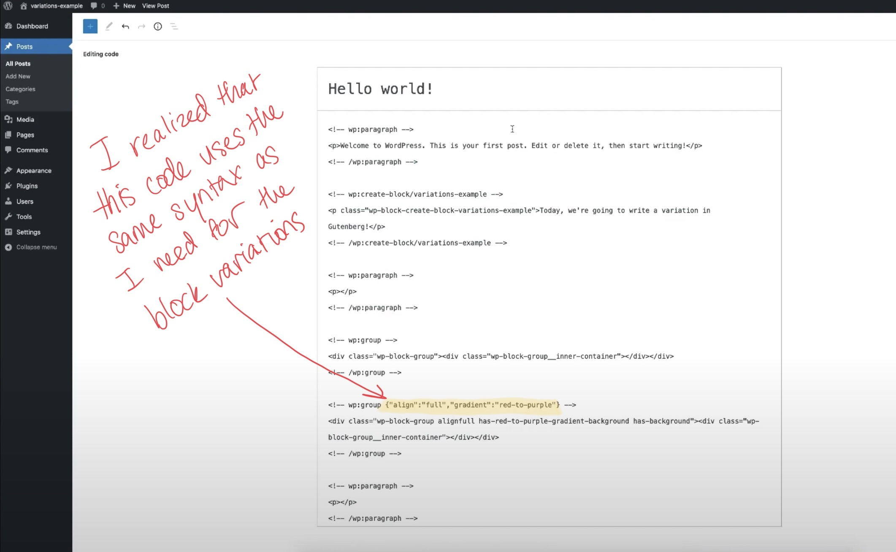
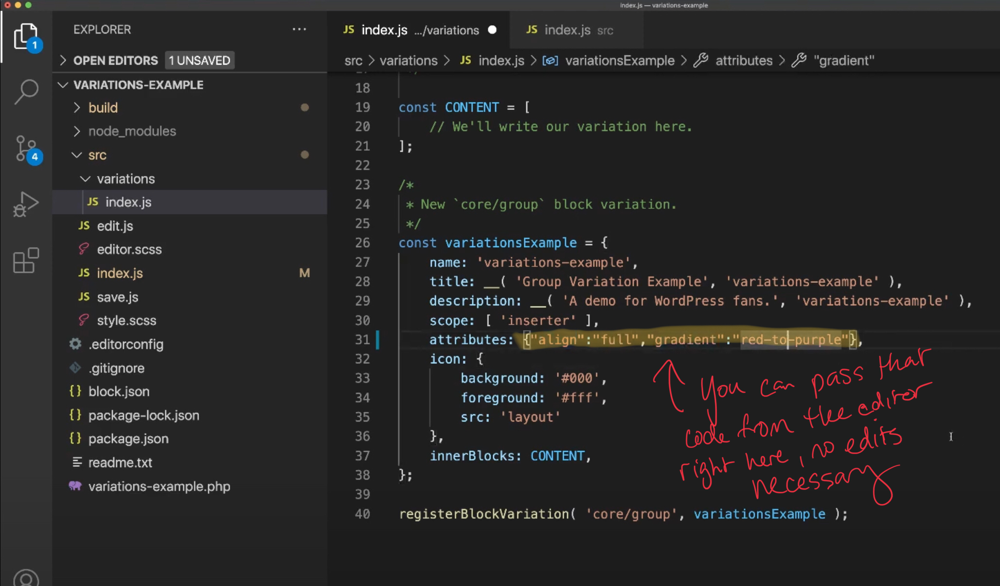
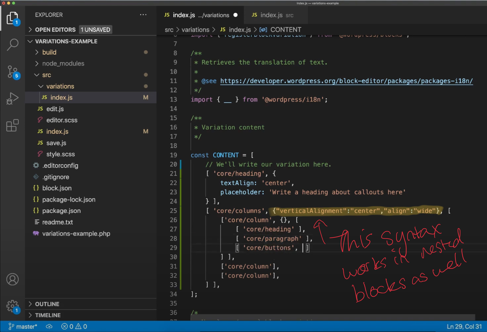

I’ve been learning Gutenberg block development lately, and one of the things I was struggling with was trying to figure out what parameters I could pass on to blocks defined in block variations. I was looking all over the place for documentation on the parameters each block takes, such as font size and color. Little did I know I had all the documentation I needed right in front of me, in the form of the WordPress code editor.

## Wait, what’s a variation?

A block variation is an easy way of leveraging WordPress core blocks (and even custom blocks you build) to create your own sets of blocks without writing any React code. You’ll need to write a bit of JavaScript, but it’s a lot like writing an array or object. If you can do that, you can write a block variation.

I like using block variations to create recommended sets of content and help guide my users in content entry. You can nest blocks in block variations, and do things like pre-set the background or font size on them.

## Use the editor to speed up block variation development

My new workflow with block variations is to build the variation just the way I like it in the visual editor, and then switch over to the code editor to grab the attributes I need from there. This lets me set hard-to-remember parameters the right way, like gradients, without having to guess and check, like so:

Once you identify the block you want to model your variation off of in the code editor, just grab those attributes and bring them back into your block variations code. [Here’s what that looks like in my final code.](https://github.com/ashleykolodziej/professorkexplains-block-variations/blob/solution-code/src/variations/index.js#L61)

This works for both your variations and your `innerBlocks`. [Here’s an example in my final code of how I used this in a nested block.](https://github.com/ashleykolodziej/professorkexplains-block-variations/blob/solution-code/src/variations/index.js#L28)

Block variations are a low key way to get into Gutenberg block development and get familiar with the ecosystem without getting into React or the more complicated bits. Check it out if you’re new to Gutenberg and looking for a place to start.

## Full tutorial

If you’re new to JavaScript or Gutenberg, I recorded my full process of building block variations using this method in a beginner-friendly way here.  I also put together [sample code in GitHub](https://github.com/ashleykolodziej/professorkexplains-block-variations) you can use to get started with a new block variation.

